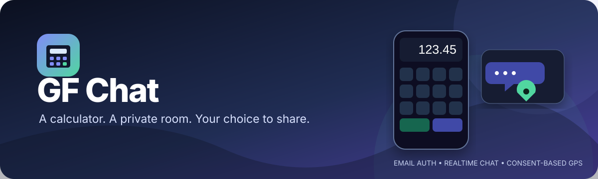
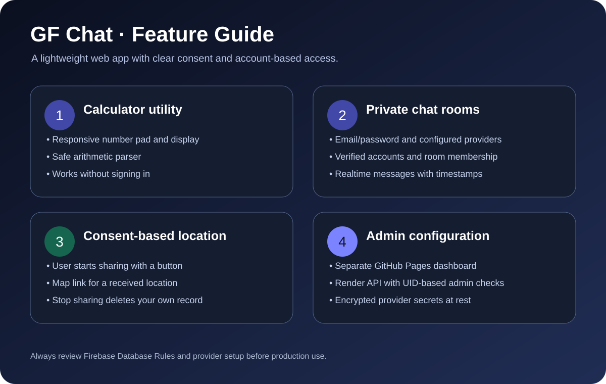
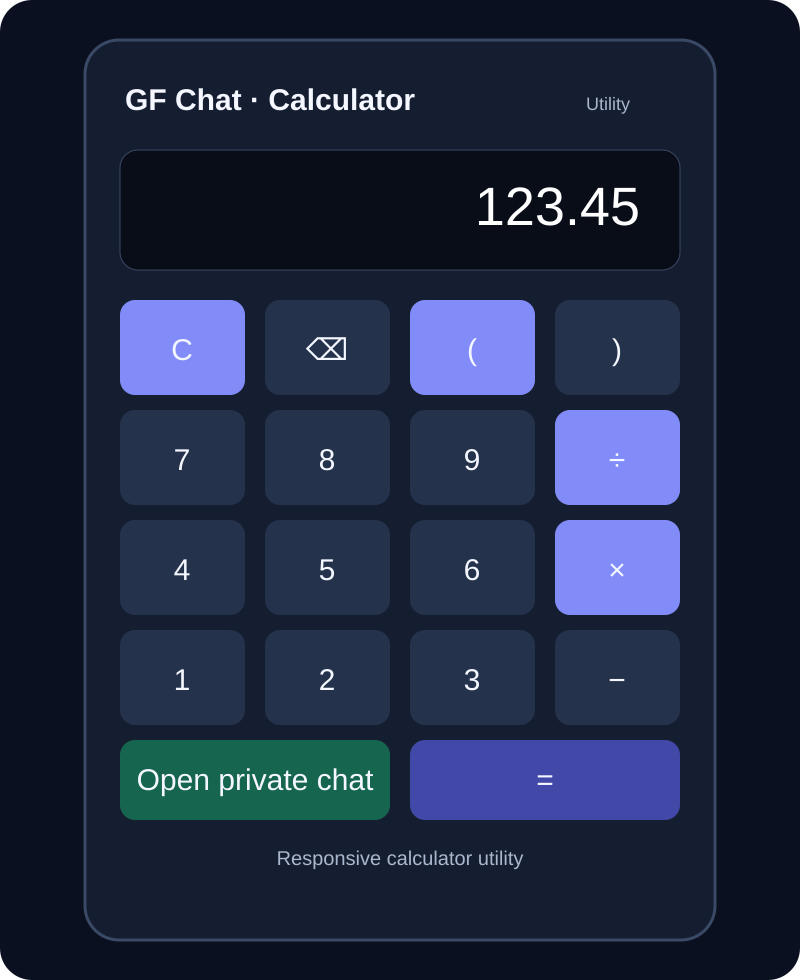
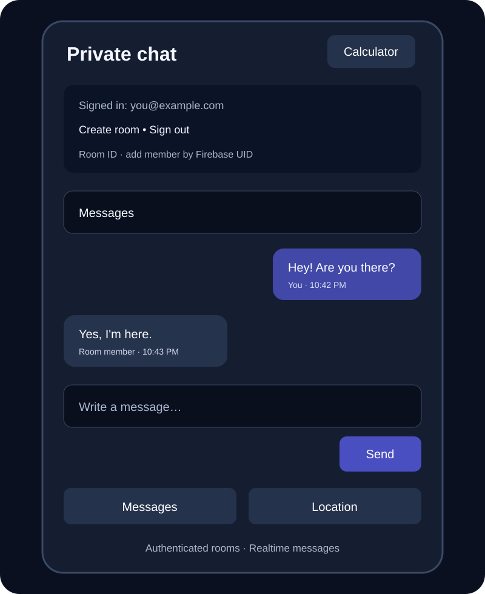

<!-- Project banner -->
<p align="center">
  
</p>

<h1 align="center">GF Chat</h1>

<p align="center">
  A mobile-friendly web app combining a calculator utility, authenticated private chat rooms, and optional one-time location sharing.
</p>

<p align="center">
  <a href="https://ahsanibnewalid.github.io/gf-chat/"><strong>🚀 Open live app</strong></a>
  ·
  <a href="https://ahsanibnewalid.github.io/gf-chat/admin.html">Authentication admin dashboard</a>
  ·
  <a href="SECURE-AUTH-ADMIN.md">Admin deployment guide</a>
</p>

<p align="center">
  
  
  
  
</p>

---

## ✨ Features at a glance

<p align="center">
  
</p>

- **Calculator utility** — responsive keypad, keyboard input, parentheses, and arithmetic parsing without JavaScript eval().
- **Authenticated accounts** — email/password registration and sign-in, email verification, and supported social providers when configured.
- **Private rooms** — create a high-entropy room ID, add another participant by Firebase UID, and check membership before loading the room.
- **Realtime messaging** — live message updates, timestamps, and a 100-message initial history window.
- **Optional location sharing** — location is requested only after a user presses Share; it is not continuous background tracking.
- **Location controls** — view a participant's latest shared coordinates and open them in Google Maps; stop sharing removes your own location record.
- **Separate authentication admin dashboard** — configure supported sign-in providers through a Render API with UID-based administrator authorization.
- **Responsive and accessible UI** — compact layouts for phones and desktops, keyboard focus styles, accessible status announcements, and reduced-motion support.

## 🖼️ Interface previews

These are **illustrated UI previews based on the current frontend code**, not captured screenshots from a running browser session.

<table>
  <tr>
    <td width="50%" align="center">
      
      <strong>Calculator utility</strong>
    </td>
    <td width="50%" align="center">
      
      <strong>Private chat and location tabs</strong>
    </td>
  </tr>
</table>

## 🧭 How it works

1. Open the [web app](https://ahsanibnewalid.github.io/gf-chat/).
2. Open **Private chat** and create an account or sign in.
3. Verify your email if verification is required by the current settings.
4. Create a room and share its room ID with the intended participant.
5. The room owner adds the participant using their Firebase Authentication UID.
6. Both members join the room to exchange realtime messages.
7. Use the **Location** tab only when you choose to share your current location.

> **Important:** A room ID is not a password. Firebase Authentication and correctly published Realtime Database rules must enforce access.

## 🏗️ Architecture

| Component | Purpose |
|---|---|
| GitHub Pages | Serves the static web app and admin dashboard |
| Firebase Authentication | Account identity and configured sign-in providers |
| Firebase Realtime Database | Room membership, messages, and per-member shared locations |
| Render / Node.js API | Verifies Firebase ID tokens and authorizes administrators |
| AES-256-GCM | Encrypts OAuth provider secrets before storage |
| Firebase Emulator Suite | Local testing of Realtime Database rules |

## 🔐 Authentication provider admin setup

The admin dashboard is separate from the chat interface. Follow [SECURE-AUTH-ADMIN.md](SECURE-AUTH-ADMIN.md) for the complete deployment checklist.

1. Deploy the backend using render.yaml or create a Render Web Service.
2. Configure the required secrets and settings in Render's Environment panel:
   - FIREBASE_SERVICE_ACCOUNT_JSON
   - SECRETS_ENCRYPTION_KEY
   - ADMIN_UIDS
   - FIREBASE_PROJECT_ID
   - FIREBASE_DATABASE_URL
   - ALLOWED_ORIGINS
3. Ensure admin-config.js contains only the public Render service URL.
4. Open the [admin dashboard](https://ahsanibnewalid.github.io/gf-chat/admin.html) and sign in with a Firebase account whose UID is listed in ADMIN_UIDS.
5. Configure each provider in its own developer console, then save and apply the provider settings.
6. Add ahsanibnewalid.github.io to Firebase Authentication's authorized domains.

Provider availability depends on Firebase and the relevant provider's developer-console setup. Merely displaying a provider button does not mean that provider is ready to authenticate users.

## 🧰 Local development and tests

**Requirements:** Node.js 20 or newer and npm.

```bash
npm install
npm run test:calculator
npm run test:rules
node --check server.js
```

The database rules tests use local Firebase emulators. Do not point test scripts at production data.

For local frontend testing, ensure firebase-config.js contains your Firebase **public web-app configuration**. Do not put service-account credentials or OAuth client secrets in frontend files.

## 🚀 Deployment

- **Frontend:** GitHub Pages publishes the static files from the configured branch/folder.
- **Admin backend:** deploy the Node.js service to Render and set environment variables in the Render dashboard.
- **Firebase:** confirm the correct project, authorized domains, Authentication providers, and Realtime Database rules.
- **HTTPS:** location sharing requires a secure context, normally the deployed HTTPS site.
- **After changes:** verify the deployed app with two separate test accounts and check browser console/network errors.

## 🛡️ Security and privacy notes

- Administrator authorization is enforced by the backend using the ADMIN_UIDS allowlist; hiding a dashboard control is not authorization.
- Provider secrets should be encrypted at rest and must never be returned by public status endpoints.
- Never commit service-account JSON, OAuth client secrets, Apple private keys, .env files containing real secrets, or SECRETS_ENCRYPTION_KEY.
- Firebase web configuration and its API key are designed to be public identifiers; database rules and backend controls still need to be correct.
- Verified email and room membership checks are important parts of the current access model. Test the deployed rules in the intended Firebase project.
- Location sharing is opt-in. A recipient may still have copied or saved a location that was shared earlier.
- Firebase Realtime Database rules do not provide robust rate limiting. Add trusted server-side abuse controls before exposing the app to a large public audience.
- Review the rules and existing data before deploying database.rules.json to a database shared with other apps.

## 📁 Useful files

- [index.html](index.html) — responsive frontend and chat interface
- [calculator.js](calculator.js) — arithmetic parser
- [firebase-config.js](firebase-config.js) — public Firebase web configuration
- [admin.html](admin.html) — authentication provider dashboard
- [admin-config.js](admin-config.js) — public backend URL configuration
- [server.js](server.js) — Render API and admin authorization
- [database.rules.json](database.rules.json) — Realtime Database access rules
- [SECURE-AUTH-ADMIN.md](SECURE-AUTH-ADMIN.md) — admin API deployment and provider setup
- [assets/](assets/) — README banner, feature infographic, and interface previews

---

<p align="center">
  Built around authenticated access, explicit sharing, and a responsive web experience.
</p>
